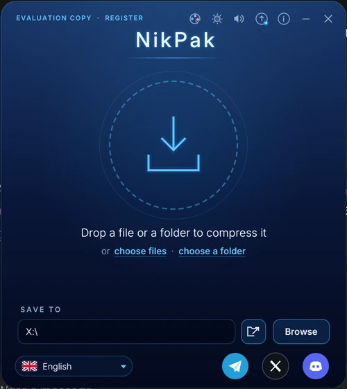
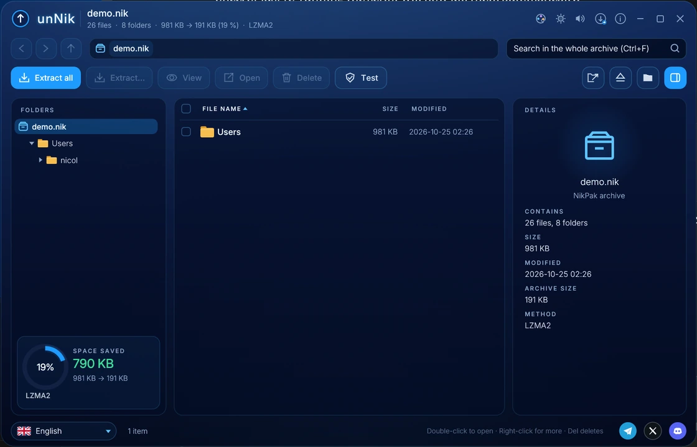
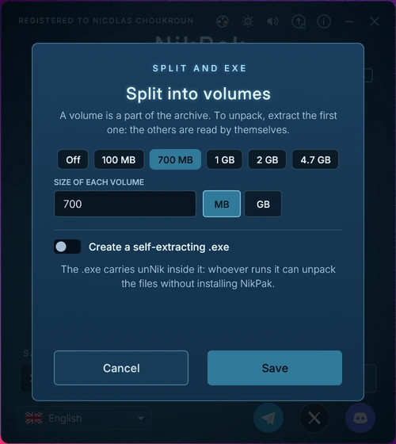
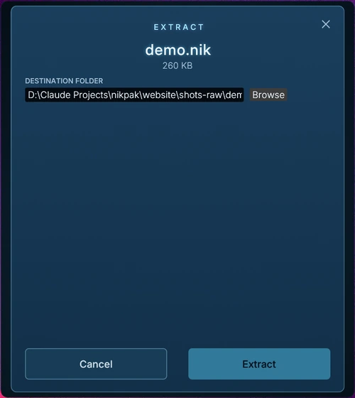
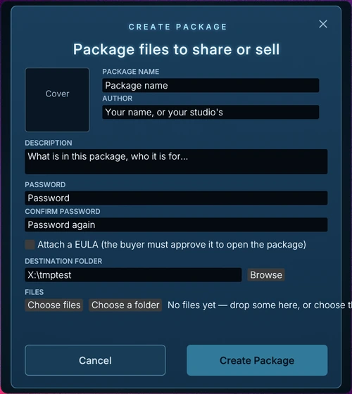
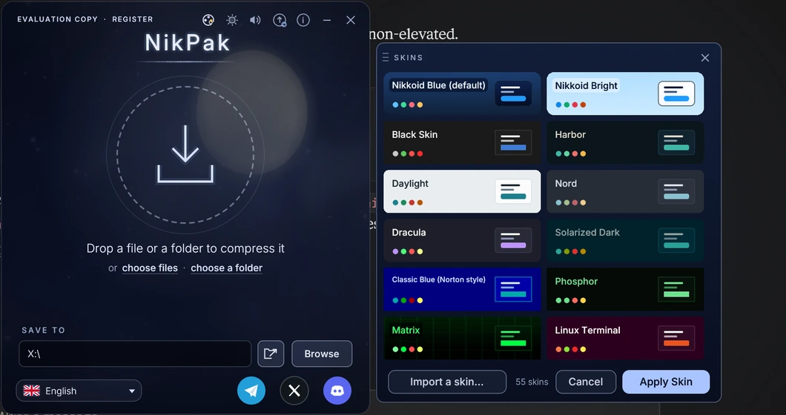

# NikPak

**A fast, encrypted archiver for the `.nik` format** — plus **unNik**, the free
archive browser that opens those archives on any machine.

<p align="center">
  
</p>

NikPak compresses with **Zstandard**, **LZMA2** and **PPMd** (plus bit-exact
**Deflate recompression** for Office files, PDF and gzip), encrypts with
**Argon2id + XChaCha20-Poly1305**, and wraps it all in a window you can skin.
Files are compressed on **all cores**, archives can be **split into volumes** or
turned into a **self-extracting `.exe`**, and you can attach a **cover picture**
and a **legal statement** that everyone must accept before extracting.

---

## What it is

NikPak is two programs:

- **nikpak** — the archiver. A window you drop files onto, and a
  command line with a RAR-style syntax (`nikpak a -p secret.nik Photos\`).
  Shareware: free for individuals, licensed per seat for companies.
- **unNik** — the free archive browser. Opens `.nik` archives in a window,
  browses folders, searches, views text, and extracts. Free for everyone,
  forever, no registration.

Both are written in Rust and run on **Windows, macOS and Linux**.

## Highlights

- **Compression that fits the data.** At the default maximum level, binary data
  goes through LZMA2 and text through PPMd, each chosen per block. Lower levels
  use multi-threaded Zstandard. Office documents (`docx`, `xlsx`, `pptx`, …),
  PDFs and `.gz` files are already Deflate-compressed inside, so NikPak decodes
  those inner streams, compresses the plain content much better, and rebuilds
  the original streams bit-for-bit when extracting.
- **Multi-core.** `-m5` splits the archive into balanced blocks and compresses
  each on its own thread; per-file work (media trials, Deflate recompression)
  runs in a pipeline at every level. `-mt<N>` is the dial, `NIKPAK_SEQ=1` the
  old one-at-a-time path.
- **Real encryption.** Argon2id key derivation + XChaCha20-Poly1305. File names
  are encrypted too, and tampering or a wrong password is detected.
- **Lossless media codecs.** WAV, AIFF, MOD and BMP are trial-compressed with
  purpose-built filters (adaptive prediction, byte-plane shuffling, a pixel
  predictor) and the smallest result is kept.
- **Split volumes.** `photos.nik` + `photos.n01` + `photos.n02` … — extract the
  first volume and the rest is read automatically.
- **Self-extracting `.exe`.** `-sfx` writes `photos.exe`: unNik with the archive
  appended, so a recipient unpacks it with nothing installed.
- **Packages.** Pack files into an encrypted, sellable `.nik` package with a
  name, description, square cover and a licence to approve — the NikPak twin of
  a soundbank.
- **Covers and legal statements.** Attach a picture and terms to any archive;
  unNik shows both before extracting.
- **Ten languages, 89 skins.** English, 中文, हिन्दी, Español, العربية, Français,
  বাংলা, Português, Русский, Bahasa Indonesia — and a skin picker from Amiga to
  ZX Spectrum.

## Screenshots

<p align="center">
  
  <br>
  <em>unNik, the free archive browser.</em>
</p>

<p align="center">
  
  
  
  <br>
  <em>Split volumes, the Extract box, and packages.</em>
</p>

<p align="center">
  
  <br>
  <em>89 skins, chosen beside the window.</em>
</p>

## Quick start

```console
nikpak a backup.nik C:\Docs\*.txt Photos\          # create an archive
nikpak a -m5 -mt8 big.nik Projects\                # maximum compression, 8 threads
nikpak a -p secret.nik Taxes2026\                  # encrypted, asks for the password
nikpak a -cover art.png -legal terms.txt pack.nik Bank\
nikpak a -v700m -mt8 video.nik Movies\             # 700 MB volumes
nikpak a -sfx -p setup.nik Installer\              # a self-extracting setup.exe
nikpak x backup.nik C:\Restore\                    # extract with paths
nikpak l backup.nik                                # list
nikpak t secret.nik                                # test (asks for the password)
```

Run `nikpak -help` for the full reference, or double-click it to open the
window and drop files on it.

## Building from source

You need Rust 1.89 or newer.

Windows (PowerShell):

```powershell
.\build.ps1                    # dist\nikpak.exe and dist\unNik.exe
.\build.ps1 -Test              # run the tests first
.\build.ps1 -Installer         # also make the setup (needs Inno Setup 6)
```

macOS / Linux:

```console
./build.sh                     # dist/nikpak and dist/unNik
sudo cp dist/nikpak dist/unNik /usr/local/bin/
```

A command-line-only `nikpak` (no window) builds with
`cargo build --release --no-default-features`.

## Licence

NikPak is **shareware**, © 2026 Nicolas Choukroun, distributed by Nikkoid LLC.
Individuals may use the evaluation copy free of charge, without time limit.
Companies and organisations need one licence per seat (personal licence $19;
company licences from $19 down to $5 per seat — see
[`LICENSE.txt`](LICENSE.txt) and <https://nikpak.nikkoid.com/buy.php>).

**unNik is freeware** — free for everyone, with no registration and no time
limit, and it may be distributed on its own.

## Links

- Website — <https://nikpak.nikkoid.com>
- User & technical guide — <https://nikpak.nikkoid.com/guide.html>
- Changelog — [`CHANGELOG.md`](CHANGELOG.md)
- Community — [Telegram](https://t.me/cryptonikko) ·
  [X](https://x.com/cryptonikkoid) ·
  [Discord](https://discord.com/users/1537826350759415811)
